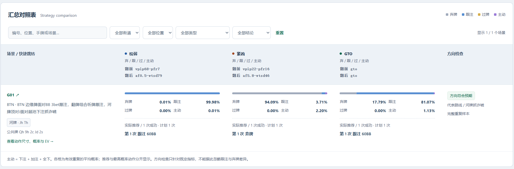
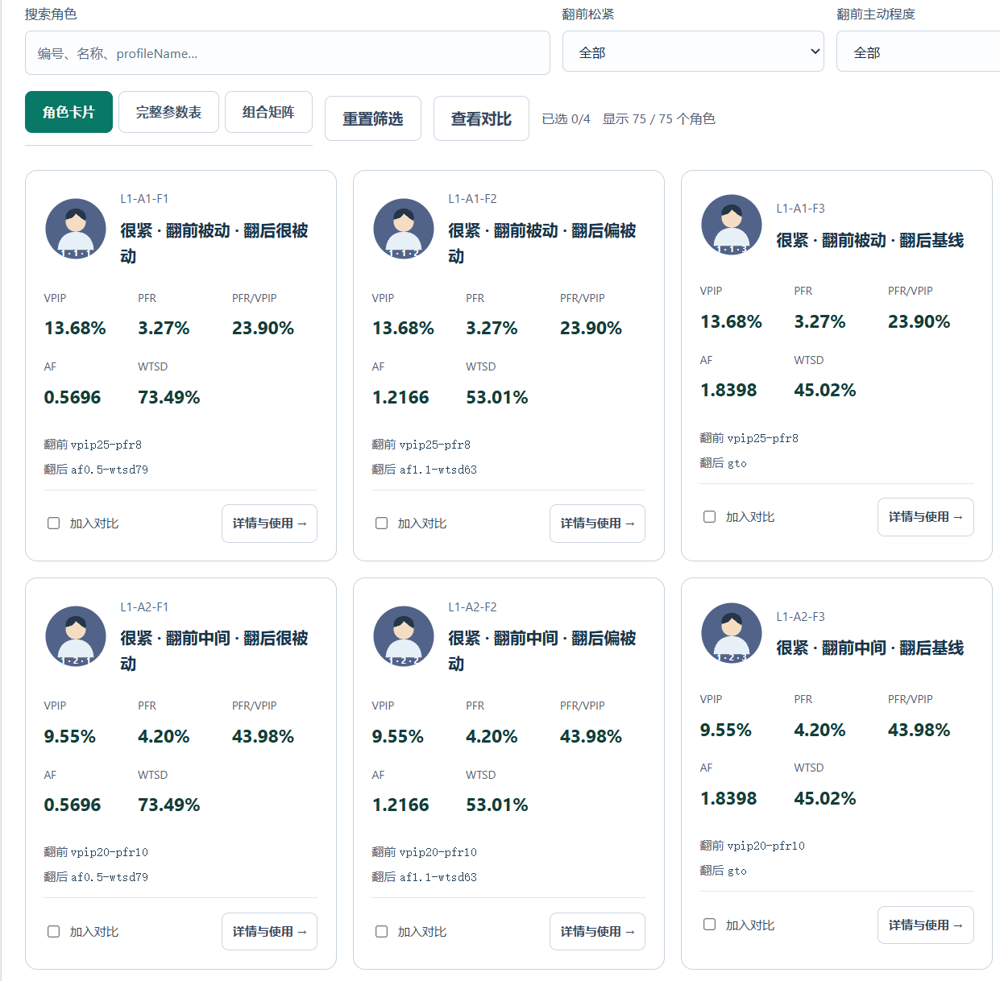
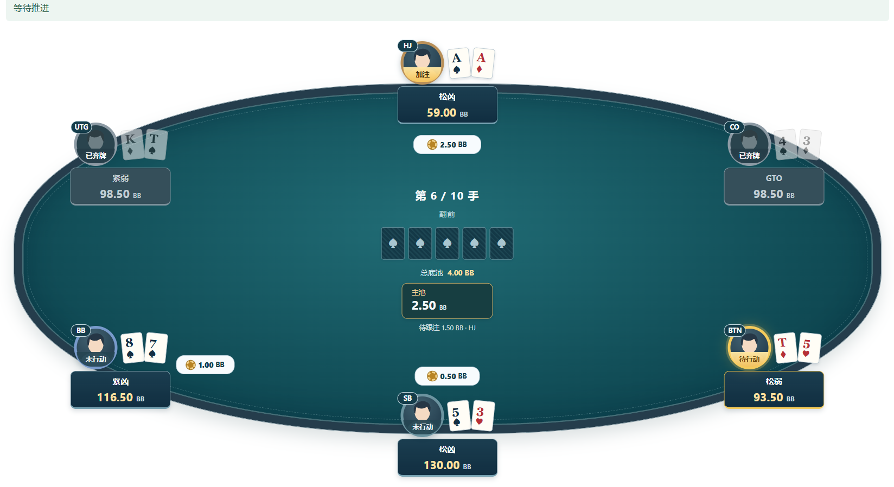
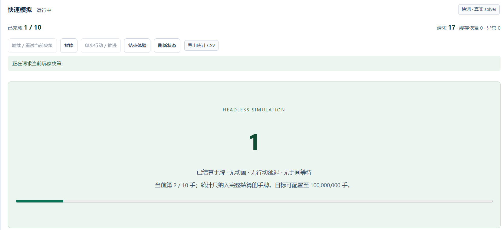

# 玩家风格实验工具进度汇报

汇报日期：2026 年 11 月 26 日

## 一、最初想确认什么

一开始，我拿不准 AI solver 返回的策略有没有体现玩家风格。所以先验证一个问题：**同样的局面，换成松弱、紧凶、GTO，打法会不会有合理的区别？**

当时有两种做法：

- 请求时传入 `strategy_profile.target_profile_name`，使用官方提供的风格档位。
- 在 solver 返回后，自己写规则调整动作概率。

我先验证了第一种。**目前使用官方返回的原始策略，还没有在本地改写概率。人工干预引擎是下一阶段要做的事。**

资料：[官方 Universal Poker API 文档](https://portal.aceguardianrl.com/docs/universal-poker#/endpoints)。

## 二、怎么验证，有什么结果

**第一步，写脚本做对照。** 底牌、位置、公共牌和行动历史都不变，只切换松弱、紧凶、GTO 三种档位，比较动作概率和下注尺寸，并确认服务实际用了哪个档位。

具体档位如下，数据取自六人实验使用的 `2-0 / 4-6p` 策略目录：

| 玩家类型 | 阶段 | 传入的 profileName | VPIP | PFR | AF | WTSD |
| --- | --- | --- | ---: | ---: | ---: | ---: |
| 松弱 | 翻前 | `vpip68-pfr7` | 67.21% | 3.41% | 1.6072 | 37.82% |
| 松弱 | 翻后 | `af0.5-wtsd79` | 36.17% | 19.22% | 0.5696 | 73.49% |
| 紧凶 | 翻前 | `vpip22-pfr16` | 12.24% | 9.58% | 2.0191 | 53.21% |
| 紧凶 | 翻后 | `af5.8-wtsd46` | 36.39% | 19.36% | 7.6845 | 24.62% |
| GTO | 翻前 | `gto` | 36.31% | 19.26% | 1.8398 | 45.02% |
| GTO | 翻后 | `gto` | 36.31% | 19.26% | 1.8398 | 45.02% |

VPIP 看入池多少，PFR 看翻前加注多少，AF 看翻后有多主动，WTSD 看见过翻牌后有多常打到摊牌。翻前、翻后分别使用对应档位。**表中是目录参考值，不是这些组合的长期实测数据；档位名字里的数字也不等于实际指标。**

初步测试能看到三种类型的区别，方向也符合预期，于是继续扩大样本。

**第二步，扩到 100 个场景。** 该有差异的地方，要看出差异；本来就应该做出相近选择的地方，也要合理，不要求每一手都不同。

| 验证 | 已有结果 | 判断 |
| --- | --- | --- |
| 100 个场景、三种类型、每组重复两次 | 600 次成功响应；89 条方向符合预期，10 条差异不明显，1 条待复核 | 整体符合预期，支持继续使用官方档位；不等于“准确率 89%”。 |
| 后续补充三条代表路线 | 18 次正式请求全部成功，覆盖面对 3bet、组合听牌、河牌超池下注 | 继续看到了差异，判断时要看完整的跟注、弃牌等概率。 |

下面这张截图可以直观看到差别：

同样是河牌面对超池下注，松弱约 **99.98% 跟注**，紧凶约 **94.09% 弃牌**，GTO 约 **81.07% 跟注**。截图是 G01 单场景、各风格一次的结果，不与上表样本合并统计。

**先确认官方档位确实能带来合理差异，再基于它扩展角色和连续牌桌，这是后续开发的出发点。** 长期表现还要继续验证。

## 三、75 种角色是怎么划分的

从现有目录选出 15 个翻前档位、5 个翻后档位，组成 **5 档松紧 × 3 档翻前主动程度 × 5 档翻后风格 = 75 种角色**。

| 维度 | 划分原则 |
| --- | --- |
| 翻前松紧：很紧、偏紧、中间、偏松、很松 | 用最低 VPIP、GTO、最高 VPIP 定两端和中间，再取两侧中点。五档目标为 9.55%、22.93%、36.31%、60.515%、84.72%。 |
| 翻前主动程度：被动、中间、主动 | 在各松紧分区内按 PFR/VPIP 选低、中、高代表，中间参考 GTO 的 53.04%。每个分区内从被动到主动递增，不统一套三段阈值。 |
| 翻后风格：很被动、偏被动、基线、偏凶、很凶 | 用最低 AF、GTO、最高 AF 定两端和中间，再选靠近两侧中点的档位。实际 AF 为 0.5696、1.2166、1.8398、4.8472、7.6845，并保留对应 WTSD。 |

目录里只有有限档位，中点只能选接近的；翻后 AF、WTSD 也会一起变化。这是本工具的分档方法。**75 种组合还没全部实测，只有翻前、翻后都为 `gto` 才是整套 GTO。**

角色库中的部分组合及对应指标：

## 四、放到连续牌桌里看表现

- 六个座位分别配置风格，每次按官方返回的概率选择动作，连续打牌，观察实际表现。
- 观看和快速模式使用同一套规则，处理全下、主池、边池和结算；快速模式省去动画和等待。

牌桌已能连续运行，后续继续积累真实 solver 样本，检查各角色长期打出来是什么样。

**观看模式：** 查看每个玩家的手牌、风格和行动。

**快速模式：** 不播放动画，按实际求解进度推进。

## 五、下一步：做产品可控的决策树

官方档位已经能体现整体风格。下一步，希望产品还能控制某个局面怎么打，以及连输、连赢后有什么变化。

**计划在 solver 返回结果后增加人工干预引擎：由产品制定规则，运行时通过决策树自动执行。尚未实现。**

处理顺序：

**原始策略＋牌局场景＋玩家风格＋情绪 → 决策树调整 → 检查动作合法性 → 行动。**

- **场景规则：** 根据位置、牌力、筹码和之前的行动，控制跟注、弃牌、加注倾向及调整幅度。
- **情绪影响：** 例如连续输牌或输掉大底池后，变得激进或谨慎；强度、持续时间和恢复速度由产品配置。
- **效果对照：** 与原始 solver 策略比较，确认规则确实改变了行为，所有调整仍要符合牌局规则。

目标是让 AI 在保持基本打法的同时，能随局面和输赢经历改变反应，更接近真人。
